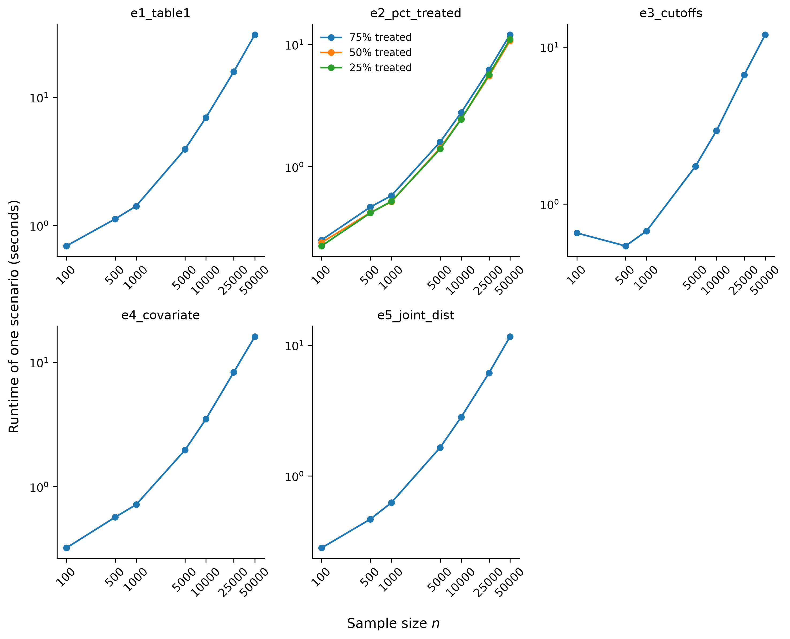

# Overall Runtime
Overall, the entire simulation study took 25.5 seconds to run.

*see results/profiling/baseline_total_runtime.txt*

# Profiling Results

I profiled experiment 1 with n=5,000 samples and 1,000 repetitions. The profiling revealed that the statsmodels fitting calls were responsible for most of the runtime. Both the probit and logit models were fit using statsmodels, and these functions were called once for every repetition of every scenario. In particular, of the 4.38 seconds required to run experiment 1 completely, 2.19 seconds were spent fitting the probit models and 1.61 seconds were spent fitting the logit models.

```
4.383 profile_experiment_1  profile_study.py:27
└─ 4.383 SimulationStudy.run  simulation.py:170
   └─ 4.353 SimulationStudy.run_scenario  simulation.py:75
      ├─ 4.258 Methods_probit.run_methods  methods.py:83
      │  ├─ 2.185 Methods_probit.fit_model  methods.py:133
      │  │  ├─ 2.018 Probit.fit  statsmodels/discrete/discrete_model.py:3152
      │  │  │     [35 frames hidden]  statsmodels, scipy, numpy
      │  │  └─ 0.157 Probit.__init__  statsmodels/discrete/discrete_model.py:540
      │  │        [10 frames hidden]  statsmodels, scipy
      │  ├─ 1.612 Methods_logit.fit_model  methods.py:112
      │  │  ├─ 1.455 Logit.fit  statsmodels/discrete/discrete_model.py:2834
      │  │  │     [26 frames hidden]  statsmodels, numpy
      │  │  └─ 0.144 Logit.__init__  statsmodels/discrete/discrete_model.py:540
      │  │        [10 frames hidden]  statsmodels, scipy
      │  ├─ 0.304 Methods_probit.plug_in_estimator  methods.py:59
      │  │  ├─ 0.226 Methods_probit.p  methods.py:43
      │  │  │  ├─ 0.140 inverse_link  methods.py:129
      │  │  │  │  └─ 0.139 norm_gen.cdf  scipy/stats/_distn_infrastructure.py:2135
      │  │  │  │        [2 frames hidden]  scipy
      │  │  │  └─ 0.076 inverse_link  methods.py:108
      │  │  └─ 0.069 link  methods.py:124
      │  │     └─ 0.068 norm_gen.ppf  scipy/stats/_distn_infrastructure.py:2305
      │  └─ 0.154 Methods_probit.itt_estimate  methods.py:72
      │     ├─ 0.078 link  methods.py:124
      │     │  └─ 0.076 norm_gen.ppf  scipy/stats/_distn_infrastructure.py:2305
      │     └─ 0.057 [self]  methods.py
      └─ 0.049 DGP_Uniform.generate_repetitions  dgps.py:75
``` 


*see results/profiling/baseline_e1_n5000_profile.html and results/profiling/baseline_e1_n5000_profile.txt for the full interactive flame graph and call tree, respectively*

# Computational Complexity

While the overall simulation study took very little time to run, this is partially due to the small sample sizes used. Adding larger values of n increased the run time for all experiments, and the run time by n did not vary strongly between experiments.



# Numerical Warnings

There were many numerical and convergence warnings resulting from the simulation study.

Experiments 3, 4, and 5 all received convergence warnings from the maximum likelihood optimization failing to converge (529, 4, and 15 such warnings for experiments 3, 4, and 5, respectively). Experiment 4 also received runtime warnings from dividing by 0, takig the log of 0, and exponential overflow (2, 4, and 70 such warnings, respectively). Experiments 3 and 5 received value errors from receiveing a probability of 0 (529 and 15 such errors respectively). Experiment 4 received 1 error from a singular matrix. All erorrs and warnings occured for scenarios with n=100 samples.

*see results/warnings/baseline for full tables of error and warnign counts*