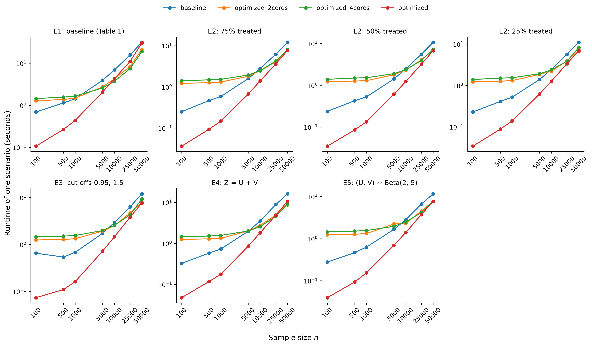

# Optimization 1: Array Programming
The baseline profiling revealed that the largest bottleneck was due to the repeated calls of statsmodels to fit the logit and probit models for all repetitions individually. To address this, I wanted to apply vectorization to eliminate the Python loops being used to generate treatment assignments and call the model fitting functions.

## Change in randomization
The first step was to change the treatment assignment process. After the true population values are sampled, the baseline version had used a for loop to randomly assign treatment and define the observed outcomes for each repetition individually. To improve this, I vectorized the treatment assignment to instead assign treatment and define the observed outcomes for all repetitions at once using 2D matrices where each row represents data for one repetition. This change improved readability of the code, but made very little difference in runtime since the treatment assignment itself had not been a large bottleneck in the profiling.

*Baseline Code:* used a for loop to generate treatment assignment and define observed outcomes for each repetition individually
```
all_repetitions = []
for sim_index in range(self.n_sim):
    trt_assignment = self.generate_treatment()
    Y_observed = trt_assignment * self.Y_treatment + (1-trt_assignment) * self.Y_control

    repetition = {
        "experiment": self.experiment,
        "sim_index": sim_index,
        "trt": trt_assignment,
        "Y_observed": Y_observed
    }
    all_repetitions.append(repetition)
```

*Optimized Code:* assigned all treatments and defined all observed outcomes at once
```
trt_assignments = self.generate_treatment()
Y_observed = trt_assignments * self.Y_treatment + (1 - trt_assignments) * self.Y_control

all_repetitions = {
    "experiment": self.experiment,
    "trt": trt_assignments,
    "Y_observed": Y_observed
}
```

## Change in model fitting
The largest bottleneck in the simulation study was a direct result of the individual model fitting calls. The baseline version had relied on repeated calls of statsmodels; however, when researching how to vectorize these calls, I could not find a pre-built vectorized version. Instead, I added code to calculate the estimators for all repetitions for a given model at once using Newton-Raphson. After implementing this process, I profiled the simulation study again and was initially disappointed to see very little improvement in runtime; however, I realized this was because the Newton-Raphson method kept running for all repetitions, even those that had already converged. So, I changed the code to only run the Newton-Raphson iterations for repetitions that had not converged. This change led to a notable improvement in runtime. While the baseline simulation study ran in 25.5 seconds, the vectorized version with the updated Newton-Raphson code ran in 8.8 seconds. 

This change also involved adding a function to calculate residuals and weights for each model to be used in the Newton-Raphson update method. To do so, I implemented the expit() function to prevent the exponential overflow seen in the baseline model when fitting the logit model. I also clipped the predicted probabilities that was causing errors when diving by or taking the log of 0 in the probit model. 

*Baseline Code:* Fit model was determined by the specific model being fit (probit or logit), and was called for every repetition for each model
```
def fit_model(self):
        intercept = np.ones(len(self.Y_observed))
        design_matrix = np.column_stack((intercept, self.trt, self.covariate_observed))

        model = sm.Probit(self.Y_observed, design_matrix)
        fit = model.fit(disp=0)

        beta_hat = fit.params
        return beta_hat
```

*Optimized Code:* The vectorized version builds a 3D design matrix for all repetitions, then runs through the Newton-Raphson model for all repetitions at once
```
def fit_model(self, tol=1e-8, maxiter=40):
        '''
        Fits the model for all repetitions using Newton-Raphson
        '''
        n_sim, n_sample = self.trt.shape

        # Build 3D design matrix
        X = np.empty((n_sim, n_sample, 3))
        X[:,:,0] = 1.0 
        X[:,:,1] = self.trt
        X[:,:,2] = self.covariate_observed
        Y = self.Y_observed

        # Define starting values
        beta = np.full((n_sim, 3), np.nan)
        converged = np.zeros(n_sim, dtype=bool)
        identity = np.eye(3)

        # Keep track of repetitions that are still running so that repetitions that are done don't keep running
        active_index = np.arange(n_sim)
        X_active = X
        Y_active = Y
        beta_active = np.zeros((n_sim, 3))

        for iteration in range(maxiter):
            # Linear predictor for each repetition
            eta = np.einsum("rni,ri->rn", X_active, beta_active, optimize=True)

            # Get residuals and weights from each specific model
            residual, weight = self.residual_and_weight(eta, Y_active)

            # Get gradient and hessian for each repetition
            gradient = np.einsum("rni,rn->ri", X_active, residual, optimize=True)
            hessian = np.einsum("rni,rn,rnj->rij", X_active, weight, X_active, optimize=True)

            # Continue running Newton-Raphson ...
```

## Trade-offs
*Code complexity and readability:* The baseline version relied on statsmodel function calls, which made it very clear to see what functions were being called, and made the code shorter. Replacing these function calls with the vectorized Newton-Raphson method made the code longer and a little hard to read through. Implementing the Newton-Raphson method also required handling toldernaces, iterations, and singular matrix checks that the statsmodels calls handled automatically, increasing the code complexity.

*Memory:* When fitting the models, the baseline version generated and analyzed one 2D design matrix at once, so it did not use much memory. In comparison, the optimized version uses 3D design matrices to fit all models at once, which requires more memory at once.

# Optimization 2: Parallelization

After vectorizing the treatment assignment and model fitting methods, the largest remaining area for improvement was that the model fitting method could still be slow, especially for large sample sizes. To account for this, I implemented parallelization to split the generated repetition data into chunks where each chunk could be computed simultaneously. For small sample sizes, implementing parallelization actually increased run time compared to the baseline unvectorized version. In these cases, the runtime was already small, so adding the parallelization likely took longer because the chunk data had to be split up, read by each core, used to fit the methods before being saved, read, and combined with the output from all other chunks. For larger sample sizes, the parallelized version had a similar run-time as the serial vectorized version, likely due to the same reason, but I suspect a runtime improvement would have been seen if larger sample sizes had been used in the complexity analysis.

*Base code:* methods were called serially for each repetition individually
```
rows = []
        for repetition in tqdm(repetition_data, desc=scenario_id, unit="rep"):
            for model in settings['models']:
                method_class = METHOD_CLASSES[model]
                start = perf_counter()
                failure_reason = ""
                error_message = ""

                with warnings.catch_warnings(record=True) as caught:
                    warnings.simplefilter('always')
                    try:
                        methods = method_class(repetition['trt'], repetition['Y_observed'], dgp.Z)
                        estimates = methods.run_methods()
                    except Exception as error:
                        estimates = {"beta1_hat": np.nan, "beta2_hat": np.nan,
                                     "beta3_hat": np.nan, "plug_in": np.nan,
                                     "itt": np.nan}
                        failure_reason = type(error).__name__
                        error_message = str(error)
```

*Parallelized code:* if parallelization is being used, the repetition data is split into chunks and assigned to different cores
```
if self.executor is None:
    # If no parallization, calculate estimates for all reps at once
    methods = method_class(repetition_data['trt'], repetition_data["Y_observed"], dgp.Z)
    estimates = methods.run_methods()
else:
    # Split up repetitions into chunks
    # Code for this else section initially generated by Claude
    trt_chunks = np.array_split(repetition_data['trt'], self.cores)
    Y_chunks = np.array_split(repetition_data['Y_observed'], self.cores)

    futures = []
    for trt_chunk, Y_chunk in zip(trt_chunks, Y_chunks):
        future = self.executor.submit(run_methods_on_chunk, method_class,
                                        trt_chunk, Y_chunk, dgp.Z)
        futures.append(future)

    # Collect results in the same order the chunks were sent, then stitch together
    chunk_results = []
    for future in futures:
        chunk_results.append(future.result())

    estimates = {}
    for key in chunk_results[0]:
        estimates[key] = np.concatenate([chunk[key] for chunk in chunk_results])
```

## Trade-offs

*Code complexity and readability:* Implementing the parallelization process required some additional functions and some additional lines of code to control and run the parallization. However, these changes did not require a lot of code, and did not notably impact the code readability.

*Memory:* Each core recieved a chunk of the data at a time, so each core processed a smaller design matrix than the serial version. As a result, each core used less memory individually than the serial version.

*Runtime:* Starting the parallization process and copying the data to and from each core takes a fixed amount of time, which caused runtime to increase in small sample sizes when there wasn't much room for improvement in the first place.

# Overall Improvements

## Profiling

Overall, the entire simulation study took 25.5 seconds to run with the baseline version,  8.8 seconds with the serial vectorized version, 7.9 with the parallel vectorized version with 2 cores, and 6.4 seconds with the parallel vectorized version with 4 cores. So, the parallel vectorized version with 4 cores had the best run-time improvement compared to the baseline. However, all 3 vectorized versions had very similar improvements in run-time compared to the baseline.

The baseline profiling of experiment 1 with n=5000 showed the probit and logit statsmodel calls were responsible for a large portion of the run-time. This can be seen in the first 20 lines of the profiling for the baseline version of the code:
```
4.383 profile_experiment_1  profile_study.py:27
└─ 4.383 SimulationStudy.run  simulation.py:170
   └─ 4.353 SimulationStudy.run_scenario  simulation.py:75
      ├─ 4.258 Methods_probit.run_methods  methods.py:83
      │  ├─ 2.185 Methods_probit.fit_model  methods.py:133
      │  │  ├─ 2.018 Probit.fit  statsmodels/discrete/discrete_model.py:3152
      │  │  │     [35 frames hidden]  statsmodels, scipy, numpy
      │  │  └─ 0.157 Probit.__init__  statsmodels/discrete/discrete_model.py:540
      │  │        [10 frames hidden]  statsmodels, scipy
      │  ├─ 1.612 Methods_logit.fit_model  methods.py:112
      │  │  ├─ 1.455 Logit.fit  statsmodels/discrete/discrete_model.py:2834
      │  │  │     [26 frames hidden]  statsmodels, numpy
      │  │  └─ 0.144 Logit.__init__  statsmodels/discrete/discrete_model.py:540
```

In comparison, the profiling of experiment 1 with n=5000 for all vectorized versions showed the probit and logit fitting still was responsible for a large portion of the run-time, but this was mostly due to the residual and weight calculations. This can be seen in the first 20 lines of the profiling for the serial vectorized version of the code: 
```
2.136 profile_experiment_1  profile_study.py:32
└─ 2.136 SimulationStudy.run  simulation.py:203
   └─ 2.107 SimulationStudy.run_scenario  simulation.py:95
      ├─ 1.869 Methods_probit.run_methods  methods.py:148
      │  ├─ 1.728 Methods_probit.fit_model  methods.py:89
      │  │  ├─ 0.923 residual_and_weight  methods.py:196
      │  │  │  ├─ 0.471 norm_gen.cdf  scipy/stats/_distn_infrastructure.py:2135
      │  │  │  │     [5 frames hidden]  scipy, numpy, <built-in>
      │  │  │  ├─ 0.321 norm_gen.pdf  scipy/stats/_distn_infrastructure.py:2054
      │  │  │  │     [5 frames hidden]  scipy, numpy, <built-in>
      │  │  │  └─ 0.118 [self]  methods.py
      │  │  ├─ 0.610 einsum  numpy/_core/einsumfunc.py:1242
      │  │  │  └─ 0.610 bmm_einsum  numpy/_core/einsumfunc.py:1144
```


The full interactive flame-graphs and tree calls for the profiles of all versions can be found in `results/profiling/`. 

## Complexity Analysis

A log-log plot of runtime vs n was used to compare the runtime between different code versions. When compared to the baseline in blue, the vectorized version (labeled optimized) in red shows a clear improvement in runtime for all sample sizes. The parallel versions with 2 cores (optimized_2cores in orange) and with 4 cores (optimized_4cores in green) showed an increased run-time for small sample sizes compared to the baseline; however, the parallel runtimes were very similar to that of the serial vectorized version for larger sample sizes. Both parallel versions had very similar runtimes, but especially at small sample sizes, the runtime was somewhat larger when using 4 cores than when using 2 cores.



## Stability

Overall, there was not a large improvement in stability. The baseline version received warnings as a result of dividing by 0, taking the log of 0, and exponential overflows. These warnings should be addressed by the changes made as part of the vectorization process; however, these warnings were created by statsmodels, so the optimized version did not track the same warnings. Additionally, these warnings only corresponded to a total of 76 repetitions in experiment 4 while the majority of the errors in the baseline version were from a failure to converge in experiment 3 (529 such errors). This was similarly seen in the vectorized version where 577 repetitions in experiment 3 failed to converge. However, this is likely due to the data itself rather than numerical instability. In experiment 3, a very small amount of the data have control outcomes of 1, so in small sample sizes, many of the repetitions don't have any control events. In these repetitions, the MLE does not exist, so the estimate cannot converge.

## Regression Testing
While the baseline and vectorized versions use the same random seed and same random stream for each scenario, the treatment assignments are drawn from that stream differently. The baseline version called `rng.chocie` once per repetition, while the vectorized version draws all treatment assingments at once. Since the population is samples first in both versions, the true values should match exactly between versions, but the estimates should only be close and not exact. Therefore, to test if the estimates are consistent between the baseline and optimized versions, we have to rely on statistical tests instead of direct comparisons. All statistical tests used a significance level of $\alpha=0.0005$ to limit the number of false positives and rejections due to the large number of comparisons being tested.

First, I implemented a test that the true population values for Table 1 were the same for the baseline and optimized versions. Then, to compare if the estimator means for each sample size in Table 1 were similar between versions, I implemented two-sided, two-sample Z-tests using the estimator means, standard deviations, and the number of valid repetitions. Similarly, to test if the estimator standard deviations for each sample size in Table 1 were similar across repetitions, I implemented an F-test of equal variance. These tests indicated that the estimator mean and SDs in Table 1 were not statistically different between the baseline and optimized versions.

This process was then generalized to test the means and SDs of estimators across all repetitions for each experiment, method, and sample size. The Z-tests indicated that the estimator means were not statistically different between the baseline and optimized versions for all experiments and methods. Additionally, the F-tests indicated that the estimator SDs were not statistically different between the baseline and optimized versions for experiments 1, 2, 3, and 5. However, this was not the case for experiment 4. To investigate this further, I applied a Kolmogorov–Smirnov test to the raw estimates for each sample size in experiment 4 to test if the estimates came from the same distribution. This indicated that all experiment 4 estimates between the baseline and optimized versions were not from statistically different distributions. So while the SDs were statistically different between the baseline and optimized versions, this may be due to some large values influencing the standard deviation. 

Overall, the largest difference in the code between the baseline and optimized versions was my implementation of the vectorized Newton-Raphson method to replace the pre-built statsmodels functions. To test if the vectorized model fitting methods I implemented produced similar results to the pre-built statsmodels, I used both methods on the same test data and compared the estimates across multiple repetitions. All repetitions had near equal estimates obtained between both methods, indicating that the vectorized Newton-Raphson method was consistent with the pre-built statsmodel functions used in the baseline version.

Finally, since the serial and parallel vectorized versions use the same treatment assignment and sampling, they should produce identical results. To test this, I directly compared the raw output from each vectorized method. All of the methods had identical raw output, meaning that adding the parallelization did not affect the results.

# Lessons Learned

The optimization that had the best return on investment was vectorizing the model fitting using the Newton-Raphson method. This change led to a dramatic improvement in simulation runtime.

After vectorizing the Newton-Raphson method, I had expected most of the runtime to be spent on running the iterations to get the estimates to converge. So, I was surprised to see that a large portion of the time in the vectorized versions was spent calculating the normal CDF and PDF for the probit residuals and weights.

Parallelization was not worth the effort. This study already used small sample sizes, so adding parallelization increased the runtime for the small sample size scenarios. While there was an overall improvement in the runtime when adding parallization, the improvement was relatively small, especially compared to the runtime improvement seen from implementing vectorization.